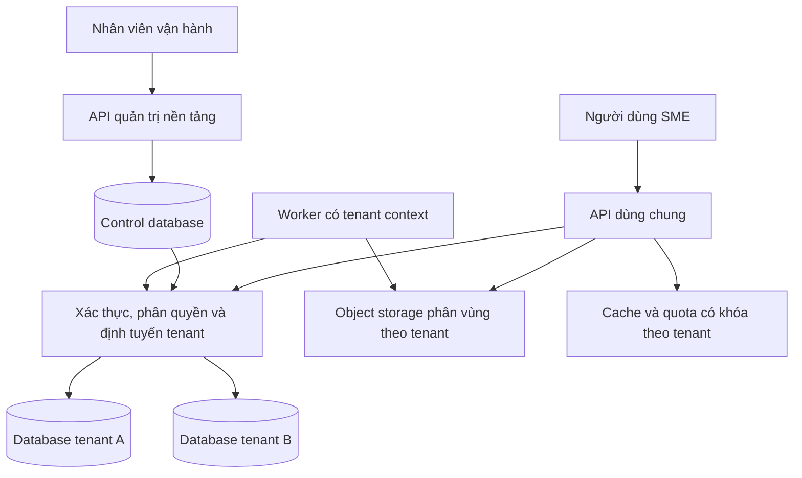

# Kiến trúc đề xuất cho SME Database-per-Tenant

> Ngày 28/10/2026. Tài liệu đề xuất dựa trên [mốc source a9675375](https://github.com/chung6a8m/dotnet-starter-kit/tree/a967537526f3b769c7d268da3ed2a6920af65ce9). Những thành phần mang tên mới dưới đây chưa tồn tại trong repo; không phải hợp đồng API đã chốt.

## 1. Mục tiêu và giả định

Mục tiêu là dùng chung một sản phẩm phục vụ nhiều doanh nghiệp SME, giữ dữ liệu nghiệp vụ mỗi tenant trong một database riêng, có thể nâng cấp, sao lưu, khôi phục và chuyển vị trí một tenant có kiểm soát.

Giả định lập đề xuất:

- Đội phát triển thiên về .NET, chấp nhận PostgreSQL và nền tảng hiện tại.
- Giai đoạn đầu là web online; chưa xử lý đồng bộ offline hoặc tách microservices.
- Mỗi tenant là một khách hàng thuê bao. MVP có thể bắt đầu một pháp nhân/tenant, nhiều chi nhánh/kho; mô hình nhiều pháp nhân cần chốt theo nghiệp vụ.
- Cùng một phiên bản sản phẩm và mô hình dữ liệu cho mọi tenant. Quyền tính năng, hạn mức và cấu hình có thể khác.
- Ưu tiên tính đúng của dữ liệu và khả năng vận hành trước tối đa mật độ tenant.

Số tenant, người dùng đồng thời, kích thước database và ngành hàng chưa được cung cấp. Không dùng bất kỳ con số giả định nào trong tài liệu để cam kết capacity hoặc giá bán.

## 2. Các phương án đã cân nhắc

| Phương án | Giá trị | Đánh đổi | Đánh giá |
|---|---|---|---|
| A. Modular monolith dùng chung API/worker, database riêng mỗi tenant | Tái sử dụng kiến trúc repo; giao dịch nội bộ tenant thuận lợi; mật độ compute tốt | Phải quản trị danh mục database và giữ tenant context xuyên mọi luồng | **Khuyến nghị cho MVP và giai đoạn tăng trưởng đầu** |
| B. Một bộ triển khai riêng cho mỗi tenant | Phù hợp khách hàng cần lịch nâng cấp, tài nguyên hoặc mạng riêng | Chi phí triển khai/giám sát/patch tăng; vẫn cần tự động hóa nhiều database | Một gói triển khai đặc biệt trong tương lai, không phải mặc định |
| C. Microservices theo nghiệp vụ ngay từ đầu | Có thể tách nhóm và nhịp triển khai độc lập | Thêm distributed transactions, contracts mạng, nhiều pipeline và nhiều thành phần phải vận hành | Chưa có bằng chứng nhu cầu đủ để bù chi phí |

Cả A và B đều giữ yêu cầu Database-per-Tenant. Shared database chỉ được dùng để giải thích hiện trạng hybrid của repo, không được chọn làm mô hình dữ liệu khách hàng thay cho yêu cầu đã đưa ra.

Khuyến nghị A là đánh giá kỹ thuật của tài liệu, chưa phải lựa chọn đã được người dùng phê duyệt. Khi phải cô lập tài nguyên mạnh hơn, thêm một cụm triển khai phục vụ một nhóm tenant hoặc một tenant lớn; không cần chuyển toàn bộ hệ thống sang microservices. [Tham khảo mô hình triển khai đa tenant của Microsoft](https://learn.microsoft.com/en-us/azure/architecture/guide/multitenant/approaches/overview)

## 3. Cấu trúc đích

Sơ đồ thể hiện ranh giới trách nhiệm; API quản trị và API nghiệp vụ có thể cùng process trong MVP. Việc tách process/host về sau phải dựa trên quyền truy cập, tải và chi phí, không dựa vào tên sơ đồ.

### 3.1. Phân bố dữ liệu

| Vị trí | Dữ liệu nên sở hữu | Ghi chú |
|---|---|---|
| Control database | Tenant registry, placement, provisioning attempts, migration ledger, subscription/plan/invoice SaaS, operator identity, support grants, outbox/inbox của control plane | Giữ cả recovery epoch và receipts điều phối cần tồn tại qua restore tenant; vẫn là dữ liệu cần bảo vệ |
| Tenant database | Identity/role/group của tenant theo phương án MVP; đối tác, hàng hóa, đơn hàng, tồn kho, công nợ; metadata tệp; audit nghiệp vụ; outbox/inbox nghiệp vụ | Các module dùng schema riêng trong cùng database |
| Object storage | Nội dung tệp, bản in, attachment | Metadata và quyền truy cập ở tenant DB; object key có tenant ID; backup/versioning phải phối hợp |
| Cache/queue | Dữ liệu tăng tốc, hạn mức tức thời, công việc chờ thực hiện | Không thay thế sổ giao dịch hoặc nguồn sự thật của billing |
| Kho phân tích về sau | Sự kiện/tổng hợp đã chọn, có tenant lineage và quyền sử dụng | Không scan tất cả tenant database trong mỗi dashboard request |

**Hiện trạng cần giữ đúng:** `TenantDbContext` và `BillingDbContext` đã dùng main DB; `BaseDbContext` và `IdentityDbContext` có đường chuyển connection theo tenant. Đưa `SupportGrant`, placement và migration ledger vào control plane là đề xuất bổ sung. [TenantDbContext](https://github.com/chung6a8m/dotnet-starter-kit/blob/a967537526f3b769c7d268da3ed2a6920af65ce9/src/Modules/Multitenancy/Modules.Multitenancy/Data/TenantDbContext.cs), [BillingDbContext](https://github.com/chung6a8m/dotnet-starter-kit/blob/a967537526f3b769c7d268da3ed2a6920af65ce9/src/Modules/Billing/Modules.Billing/Data/BillingDbContext.cs)

“Database-per-Tenant” trong đề xuất nghĩa là **dữ liệu nghiệp vụ thuộc tenant được lưu riêng**; không hứa mọi metadata thuê bao và vận hành đều nằm trong tenant DB.

### 3.2. Một database/tenant, không một database/module/tenant

Giữ một database cho tenant với các schema như `identity`, `catalog`, `sales`, `inventory`, `receivables`, `audit`, `framework`. Tên schema mới chỉ mang tính minh họa.

Mỗi module vẫn sở hữu bảng, migrations và contracts của mình. Module khác không truy cập runtime project hoặc tự ý cập nhật bảng của module đó. Khi cần giao dịch mạnh giữa bán hàng và tồn kho, thực hiện một use case điều phối có hợp đồng rõ và transaction trên cùng database; tránh dùng event bất đồng bộ cho một điều kiện bắt buộc phải đúng ngay.

Tách database theo module từ đầu sẽ biến một giao dịch SME đơn giản thành bài toán phân tán và nhân chi phí vận hành lên theo cả số tenant lẫn số module.

## 4. Các bất biến phải có

1. Tenant khách hàng có database descriptor hợp lệ và duy nhất theo chính sách triển khai. Mặc định không cho hai tenant chia sẻ cùng một database.
2. Tenant context được xác lập trước khi resolve bất kỳ tenant DbContext nào, và không đổi giữa một đơn vị công việc.
3. Với tenant đã xác thực, database lấy từ registry nội bộ; header/query/DTO không được mang connection string hay ghi đè tenant claim.
4. Tenant data plane thiếu descriptor, thiếu secret, chưa Ready hoặc sai version thì từ chối thao tác; không fallback về default database.
5. Root/control plane là ngoại lệ được định danh rõ. “Không có tenant” không được ngầm hiểu là root.
6. Giữ `TenantId` và tenant filters như một lớp kiểm tra bổ sung; kiểm cả raw SQL, bulk operations, background code và các entity `IGlobalEntity`.
7. Giao dịch chỉ bao phủ một database vật lý. Control DB và tenant DB cần workflow có retry/compensation.
8. Module và event contract giữ tương thích trong cửa sổ rollout; một tenant lỗi không được biến thành sự cố cho tất cả tenant.

Điểm 4 là thay đổi có chủ đích so với hybrid fallback hiện tại trong [BaseDbContext.OnConfiguring](https://github.com/chung6a8m/dotnet-starter-kit/blob/a967537526f3b769c7d268da3ed2a6920af65ce9/src/BuildingBlocks/Persistence/Context/BaseDbContext.cs). Không chỉ thêm validation ở giao diện tạo tenant: phải thực thi tại tất cả đường khởi tạo data-plane context.

## 5. Tenant registry và phân giải kết nối

Nên mở rộng registry bằng một database descriptor thay vì xem connection string là toàn bộ mô hình tenant.

| Thuộc tính khái niệm | Mục đích |
|---|---|
| `TenantId` bất biến, `Slug`/domain có thể thay | Định danh nội bộ tách khỏi tên hiển thị và URL |
| `DatabaseId`, `PlacementId`, `Region` | Nhận diện database logic và cụm chứa nó |
| `RuntimeSecretRef` | Tham chiếu thông tin kết nối quyền hạn tối thiểu |
| `MigrationSecretRef` hoặc danh tính migrator | Tách quyền thay đổi schema; worker nghiệp vụ không được đọc |
| `RoutingVersion` | Làm mới cache, vô hiệu hóa kết nối cũ khi rotate/move/restore |
| `ProvisioningStatus`, `AccessStatus`, `DataOperationStatus` | Tách “đã tạo xong”, “được phép truy cập”, “đang bảo trì/khôi phục” |
| `SchemaRelease` và ledger theo module | Theo dõi khả năng tương thích với phiên bản ứng dụng |
| `PlanId`, hạn mức, policy backup | Cấu hình dịch vụ; không quyết định quyền DB bằng tên gói đơn thuần |

Đây là mô hình logic, không phải yêu cầu tạo ngay tất cả bảng. Bắt đầu bằng số trường cần cho isolation, recovery và vận hành; tách bảng khi có vòng đời/quan hệ khác nhau.

Một resolver trung tâm cần:

- Xác minh tenant tồn tại và trạng thái cho phép thao tác.
- Lấy descriptor và secret từ kênh tin cậy, với cache có thời hạn và version.
- Tạo connection phù hợp mục đích runtime/migration; kiểm allowlist endpoint, database name và certificate/TLS theo môi trường.
- Gắn tenant/database identity vào log đã loại secret.
- Tạo scope/context đã khóa định tuyến; dispose đầy đủ cuối công việc.

Không lấy database name trực tiếp từ tên công ty nhập bởi người dùng. Không cho khách hàng tự truyền host/credential vào API nghiệp vụ. Nếu có gói bring-your-own-database sau này, nó phải có quy trình thẩm định kết nối và hỗ trợ vận hành riêng.

## 6. Identity, tenant switching và hỗ trợ khách hàng

### 6.1. Phương án MVP: identity theo tenant

Repo dùng `MultiTenantIdentityDbContext` và chuyển kết nối dựa trên tenant. Giữ cách này giúp ít thay đổi nền và cho phép khôi phục identity cùng dữ liệu khách hàng. [IdentityDbContext](https://github.com/chung6a8m/dotnet-starter-kit/blob/a967537526f3b769c7d268da3ed2a6920af65ce9/src/Modules/Identity/Modules.Identity/Data/IdentityDbContext.cs)

Hệ quả cần chấp nhận:

- Danh tính được hiểu là cặp `(TenantId, UserId)`, không chỉ email.
- Cùng một email ở hai tenant có thể là hai tài khoản, mật khẩu/MFA/session riêng.
- Chuyển tenant cần xác thực/chứng minh quyền ở tenant đích và cấp token mới; không chỉ đổi header.
- Login có thể nhận slug/subdomain để xác định tenant trước khi tra user; mọi đường callback/reset password/email confirmation cũng phải mang tenant identity được xác minh.
- Root operator có danh tính riêng; không sử dụng tenant admin của khách hàng làm tài khoản vận hành.

Không suy diễn identity theo tenant thành có sẵn global SSO hay membership xuyên tenant.

### 6.2. Khi nào chọn global identity?

Nếu ngay từ đầu một kế toán dịch vụ phải dùng một tài khoản vào nhiều khách hàng, hoặc sản phẩm cần SSO doanh nghiệp chung, nên quyết định sớm:

- Identity provider/global user store ở control plane.
- Bảng membership `(SubjectId, TenantId)`, role/data scope gắn tenant.
- Token/session có tenant được chọn và quyền tương ứng; thu hồi membership phải có hiệu lực theo SLA bảo mật.
- Dữ liệu nghiệp vụ chỉ giữ tham chiếu subject, không FK xuyên database.
- Tenant restore không khôi phục mật khẩu/token toàn cục; phải đối soát membership sau restore.

Đây là một nhánh thiết kế có chi phí thật. Không triển khai đồng thời cả hai mô hình chỉ để “dự phòng”. Khuyến nghị mặc định giữ identity hiện tại; chuyển lựa chọn khi yêu cầu multi-membership/SSO được xác nhận.

### 6.3. Phân biệt người thao tác, danh tính được đại diện và database đích

Tenant context cho các use case nhạy cảm nên phân biệt:

| Trường | Ý nghĩa |
|---|---|
| `ActorUserId / ActorTenantId` | Người thực sự khởi tạo thao tác |
| `SubjectUserId / SubjectTenantId` | Danh tính đang được đại diện khi impersonation |
| `EffectiveTenantId` | Tenant sở hữu dữ liệu đang truy cập |
| `SupportGrantId`, reason, expires-at | Căn cứ hỗ trợ và thời hạn |
| `CorrelationId`, `OperationId` | Truy vết và chống thực thi lặp |

Bình thường ba tenant này trùng nhau. Khi hỗ trợ khách hàng, chúng có thể khác; quota, object key, DbContext và audit dữ liệu phải lấy đúng effective tenant, trong khi quyền operator thuộc actor.

Repo có root header override và impersonation grants, nhưng `CurrentUserService.GetTenant()` vẫn đọc claim; việc đổi Finbuckle context không đổi claim. Vì thế cần rà từng luồng; không coi root override là hợp đồng đã bảo đảm đúng trên mọi endpoint. [CurrentUserService](https://github.com/chung6a8m/dotnet-starter-kit/blob/a967537526f3b769c7d268da3ed2a6920af65ce9/src/Modules/Identity/Modules.Identity/Services/CurrentUserService.cs), [MultitenancyModule](https://github.com/chung6a8m/dotnet-starter-kit/blob/a967537526f3b769c7d268da3ed2a6920af65ce9/src/Modules/Multitenancy/Modules.Multitenancy/MultitenancyModule.cs)

Đề xuất support access qua endpoint allowlist, quyền riêng, reason và grant có hạn; mặc định chỉ đọc, ghi phải được phân quyền rõ. Trước khi có test dedicated DB, không bật support impersonation rộng cho production.

## 7. Phân quyền nghiệp vụ trong tenant

Database isolation giải quyết ranh giới khách hàng; SME còn cần ranh giới công ty, chi nhánh, kho và người phụ trách.

Quyền quyết định một thao tác nên là giao của:

`quyền tính năng ∩ phạm vi dữ liệu ∩ trạng thái chứng từ ∩ hạn mức phê duyệt`.

Ví dụ: người dùng có `Sales.Order.Approve`, chỉ được duyệt đơn thuộc các chi nhánh được cấp, chứng từ ở trạng thái Chờ duyệt, và giá trị dưới hạn mức. Điều kiện này phải được thực thi trong API/query/command, không chỉ ẩn nút.

Các khóa quan trọng nên có phạm vi nghiệp vụ rõ: số chứng từ theo `CompanyId + loại chứng từ + kỳ + số`; mã hàng theo công ty hoặc tenant tùy quyết định; khóa tồn theo `CompanyId + WarehouseId + ItemId + dimensions`. Đặt constraint và index theo mô hình đã chọn; không chỉ nối `TenantId` vào tất cả khóa rồi coi như đủ.

## 8. Transaction, outbox và tính đúng của nghiệp vụ

### 8.1. Giao dịch trong một tenant database

Một thao tác như ghi nhận xuất kho phải cập nhật chứng từ, sổ kho và outbox trong cùng transaction nếu chúng phải thành công hoặc thất bại cùng nhau. Repo có scoped connection provider và ambient transaction registry cho các context kế thừa đúng pipeline; test hiện có chứng minh chủ đích thiết kế trên root/shared DB, chưa thay thế test dedicated DB. [ScopedDbConnectionProvider](https://github.com/chung6a8m/dotnet-starter-kit/blob/a967537526f3b769c7d268da3ed2a6920af65ce9/src/BuildingBlocks/Persistence/ScopedDbConnectionProvider.cs), [OutboxAtomicityTests](https://github.com/chung6a8m/dotnet-starter-kit/blob/a967537526f3b769c7d268da3ed2a6920af65ce9/src/Tests/Integration.Tests/Tests/Eventing/OutboxAtomicityTests.cs)

Gọi `SaveChanges` hai lần trên hai context không tự tạo một transaction chung. EF Core yêu cầu cùng `DbConnection` và `DbTransaction` để chia sẻ transaction giữa context. [Microsoft: Transactions](https://learn.microsoft.com/en-us/ef/core/saving/transactions)

Với số chứng từ và tồn kho, dùng unique constraints, optimistic concurrency/locking phù hợp và idempotency key bền vững. Không cấp số bằng `MAX + 1` ngoài transaction; không kiểm số tồn rồi cập nhật không có kiểm soát cạnh tranh.

### 8.2. Control plane và data plane

Tạo tenant, cấp database, ghi subscription và gửi invitation không thể là một transaction ACID xuyên mọi thành phần.

Đề xuất workflow có trạng thái bền, idempotency, retry và compensation; control-plane write dùng outbox cùng control DB, tenant business write dùng outbox cùng tenant DB. Các consumer phải biết loại dữ liệu mình sở hữu. Không chuyển Billing vào tenant DB chỉ vì event có `TenantId`; không dùng một ambient tenant context để đoán nơi lưu mọi loại dữ liệu.

**Quy tắc định tuyến:** outbox đi theo nơi lưu dữ liệu của **producer**; inbox đi theo nơi lưu side effect của **consumer**. `TenantId` trong event thể hiện đối tượng nghiệp vụ/attribution, không đủ để chọn database:

| Luồng | Nơi ghi outbox | Nơi ghi side effect và inbox |
|---|---|---|
| Tạo/gia hạn tenant → Billing SaaS | Control DB cùng thay đổi catalog | Control DB cùng subscription/invoice |
| File/đơn bán tenant A → consumer nghiệp vụ A | Database A | Database A |
| Sự kiện A → consumer tổng hợp vận hành | Database A | Control/analytics store theo ownership đã đăng ký |

Registry của producer/handler phải chỉ rõ control-plane hay tenant-data-plane; consumer tenant cần full descriptor, consumer control cần scope control rõ ràng. Không cho payload do bên ngoài gửi tự chọn plane/database. Không thêm nhiều đăng ký `IInboxStore` theo module khiến DI chọn registration cuối; chọn execution scope đúng ownership trước khi resolve context/inbox.

Đây là phần cần bổ sung vào kiến trúc eventing hiện tại: `BillingService` ghi `BillingDbContext` trung tâm nhưng gọi `IOutboxWriter` theo context hiện hành; bus resolve các handler cùng một inbox trong scope dispatch. Chỉ sửa K01 bằng cách nạp full tenant connection cho mọi event có thể chuyển inbox/outbox của luồng control sang tenant DB. Phải kiểm riêng cả fixed-tier subscription/renewal và luồng data plane. [BillingService](https://github.com/chung6a8m/dotnet-starter-kit/blob/a967537526f3b769c7d268da3ed2a6920af65ce9/src/Modules/Billing/Modules.Billing/Services/BillingService.cs), [InMemoryEventBus](https://github.com/chung6a8m/dotnet-starter-kit/blob/a967537526f3b769c7d268da3ed2a6920af65ce9/src/BuildingBlocks/Eventing/InMemory/InMemoryEventBus.cs)

### 8.3. Consumer và inbox

Outbox/inbox cung cấp nền cho giao nhận ít nhất một lần. Phải xử lý tình huống worker đã tạo side effect nhưng chết trước khi đánh dấu inbox:

- Với side effect nội bộ DB: inbox marker và thay đổi nghiệp vụ cùng transaction, cộng unique business key.
- Với email, webhook, payment hoặc hệ thống bên ngoài: khóa idempotency/receipt riêng và cơ chế đối soát.
- Event thuộc tenant phải có tenant ID, event ID, correlation/causation và version contract; không chứa secret hoặc toàn bộ tenant descriptor. Event toàn cục phải khai báo scope control/global rõ ràng, không dùng tenant ID rỗng để ngầm chọn root hoặc database đang có trong ambient context.
- Background scope phải chọn plane theo ownership của consumer; với consumer tenant, resolve đầy đủ tenant descriptor trước khi tạo consumer/context. Identity-only context không đủ cho database riêng.

[InMemoryEventBus](https://github.com/chung6a8m/dotnet-starter-kit/blob/a967537526f3b769c7d268da3ed2a6920af65ce9/src/BuildingBlocks/Eventing/InMemory/InMemoryEventBus.cs) hiện gọi handler rồi mới đánh dấu inbox. [FinbuckleEventTenantScope](https://github.com/chung6a8m/dotnet-starter-kit/blob/a967537526f3b769c7d268da3ed2a6920af65ce9/src/Modules/Multitenancy/Modules.Multitenancy/Services/FinbuckleEventTenantScope.cs) hiện chỉ dựng tenant theo ID. Hai điểm này cần được xử lý và kiểm thử theo yêu cầu ở tài liệu 03.

## 9. Cache, jobs, tệp và realtime

| Thành phần | Quy ước đề xuất |
|---|---|
| Cache nghiệp vụ | Khóa chứa tenant, module, resource; dữ liệu theo user thêm subject namespace; có phiên bản để vô hiệu khi restore |
| Permission cache | Khóa theo `SubjectTenantId + UserId + PermissionVersion`; quyền actor operator dùng actor namespace |
| Jobs | Payload chứa tenant ID, operation ID và tham số tối thiểu; worker tra registry mới nhất, không serialize connection string |
| Object storage | Object key/prefix theo immutable tenant ID; metadata, quyền tải và URL có hạn đều kiểm tenant |
| Realtime | Connection/group có tenant namespace; authorize trước join group; khi tenant/token thay đổi phải thiết lập lại kết nối |
| Search/export | Request, index partition, file kết quả và link tải đều gắn tenant; job export có quota và thời hạn |
| Audit | Ghi actor/subject/effective tenant, module, object, kết quả và correlation; lọc dữ liệu nhạy cảm |
| Analytics | Export theo hợp đồng dữ liệu tối thiểu; giữ provenance để xóa/khôi phục/đối soát |

Repo đã có nhiều phần trong bảng; đây là tiêu chuẩn thống nhất cho sản phẩm, không phải khẳng định tất cả còn thiếu. Ví dụ `SqlAuditSink` và `WebhookDispatchJob` có lookup tenant đầy đủ, trong khi cache permission hiện chỉ có `UserId`, và Hangfire filter lưu `AppTenantInfo`. [SqlAuditSink](https://github.com/chung6a8m/dotnet-starter-kit/blob/a967537526f3b769c7d268da3ed2a6920af65ce9/src/Modules/Auditing/Modules.Auditing/Persistence/SqlAuditSink.cs), [CacheKeys](https://github.com/chung6a8m/dotnet-starter-kit/blob/a967537526f3b769c7d268da3ed2a6920af65ce9/src/BuildingBlocks/Caching/CacheKeys.cs), [FshJobFilter](https://github.com/chung6a8m/dotnet-starter-kit/blob/a967537526f3b769c7d268da3ed2a6920af65ce9/src/BuildingBlocks/Jobs/FshJobFilter.cs)

## 10. Chọn PostgreSQL và bảo trì fork

Khuyến nghị giữ PostgreSQL cho bản đầu. Repo có nhánh cấu hình SQL Server, nhưng migration assembly chính, advisory locks, một số query/index/audit và outbox claiming gắn PostgreSQL. Đổi provider không đồng nghĩa đã port đủ sản phẩm. Nếu SQL Server là điều kiện bắt buộc, tạo một workstream riêng cho migrations, kiểu dữ liệu, locking, JSON/search, jobs, atomicity và integration tests. [OptionsBuilderExtensions](https://github.com/chung6a8m/dotnet-starter-kit/blob/a967537526f3b769c7d268da3ed2a6920af65ce9/src/BuildingBlocks/Persistence/OptionsBuilderExtensions.cs), [AuditDbContext](https://github.com/chung6a8m/dotnet-starter-kit/blob/a967537526f3b769c7d268da3ed2a6920af65ce9/src/Modules/Auditing/Modules.Auditing/Persistence/AuditDbContext.cs), [EfCoreOutboxStore](https://github.com/chung6a8m/dotnet-starter-kit/blob/a967537526f3b769c7d268da3ed2a6920af65ce9/src/BuildingBlocks/Eventing/Outbox/EfCoreOutboxStore.cs)

Giữ nguyên phần nền có ích, thêm module SME qua Contracts, ghi ADR cho các thay đổi ảnh hưởng nhiều module. Với upstream, pin mốc, đọc diff, tiếp nhận theo nhóm nhỏ và chạy bộ kiểm thử riêng cho Database-per-Tenant. Không merge tự động chỉ vì upstream mô tả “production-ready”.

`AGENTS.md` yêu cầu chấp thuận rõ trước khi sửa `src/BuildingBlocks`. Đợt này chỉ viết tài liệu; những thay đổi resolver/cache/job/eventing vào BuildingBlocks cần được xác định phạm vi và xin chấp thuận ở giai đoạn triển khai. [Quy tắc repository](https://github.com/chung6a8m/dotnet-starter-kit/blob/a967537526f3b769c7d268da3ed2a6920af65ce9/AGENTS.md)

## 11. Những quyết định cần chốt trước khi triển khai

| Quyết định | Mặc định đề xuất | Điều gì làm thay đổi |
|---|---|---|
| Ngành/luồng nghiệp vụ | SME thương mại hoặc dịch vụ, một chuỗi nghiệp vụ đầu-cuối | Sản xuất, kế toán đầy đủ, POS offline |
| Tenant ↔ pháp nhân | Một khách hàng là một tenant; MVP một pháp nhân, nhiều chi nhánh | Tập đoàn, đại lý kế toán, tách dữ liệu theo pháp nhân |
| Identity | Tenant-local | Một user nhiều tenant, federation/SSO bắt buộc |
| Database engine | PostgreSQL | Quy định nội bộ hoặc hệ sinh thái tích hợp buộc SQL Server |
| SLA phục hồi | Đo bằng restore drill rồi ký cam kết | Quy mô dữ liệu, ngân sách, nhu cầu khách hàng |
| Support access | Có grant, có audit, hạn chế ghi | Quy trình vận hành đã được chủ sản phẩm phê duyệt |
| Tùy biến | Cấu hình/extension point, cùng schema | Hợp đồng bắt buộc bản triển khai riêng |

Các quyết định này là đầu vào cho giai đoạn triển khai, không ngăn việc hoàn thành bộ tài liệu phân tích hiện tại.
